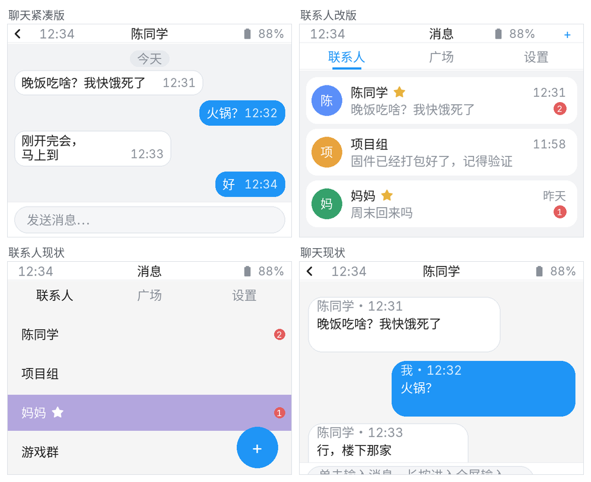
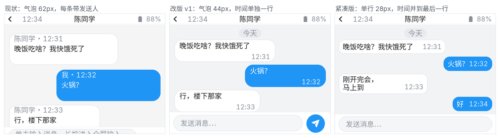
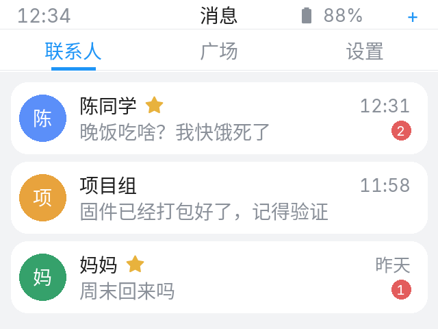

# 聊天页面优化方案

> 提案稿，先确认再改代码。预览图按 320×240、14px Sarasa UI SC 渲染，生成脚本在 `generate_mockups.py`。
>
> **落地进度：P1–P4 已实现**（会话页、联系人列表、广场同步、设置卡片、弹层；联系人 Tab 用白色 tab 栏 + 蓝色下划线指示）。



## 0. 结论

聊天页现在功能都在，但视觉还是“默认 LVGL 列表 + 每条气泡重复发送人/时间 + 底部输入框被裁”。建议按系统现有的设计语言重做：

- **会话页**：浅灰底、白/蓝气泡、日期分隔、气泡内只留时间、固定输入栏 + 发送按钮；
- **联系人**：头像行 + 最后消息预览 + 时间 + 未读徽标，收藏从“整行紫底”改成小星标；
- **添加联系人**：从列表里的浮动加号搬到状态栏右侧“+”；
- **广场 / 设置**：同风格气泡与卡片行。

---

## 1. 现状审计

| # | 问题 | 位置 |
|---|---|---|
| 1 | 会话容器还是 `y:18 h:222`，状态栏现在是 22px 不透明，顶部 4px 被盖住 | `message-lvgl.yaml:350-357` |
| 2 | 输入框 `align: BOTTOM_MID, y: 15`，底边被裁掉约 15px，只露出 25px | `message-lvgl.yaml:378-385`、`192-199` |
| 3 | 每条气泡都带“发送人 · 时间”元信息，1:1 聊天里“我/陈同学”重复出现，气泡显得很重 | `message.yaml:912-914` |
| 4 | 气泡最大宽度 224，对方气泡 #EEF2F6、自己 #1F95F6；没有日期分隔、没有连续消息合并 | `message.yaml:921-960` |
| 5 | 联系人列表是默认 `lv_list` 文本行：没有头像/预览/时间；收藏用整行紫底 + 星号拼在名字里；未读只是 8px 红点 | `message.yaml:283-359` |
| 6 | 添加联系人是列表里的浮动 46px 加号，会跟最后一行/滚动条打架 | `message.yaml:361-369` |
| 7 | Tab 是默认 tabview（15% 高），圆点红点靠 `lv_obj_align` 硬算位置 | `message-lvgl.yaml:147-168`、`message.yaml` `message_init_unread_dots` |
| 8 | “其他会话未读”红点 `dot_back_unread` 是旧返回按钮的遗留，现在浮在状态栏下面 | `message-lvgl.yaml:366-377` |
| 9 | 设置 Tab 是裸 label + switch，没有分组/卡片；危险按钮是整块红/橙 | `message-lvgl.yaml:219-333` |
| 10 | 添加联系人/联系人操作/消息操作三个弹层是默认白卡 + 彩色按钮，和系统其它弹层不一致 | `message-lvgl.yaml:405-648` |
| 11 | 键盘展开时列表高度/输入框位置在脚本里硬编码（168→73、y 15→-80），和 22px 状态栏叠加后空间更紧 | `message-lvgl.yaml:677-770` |
| 12 | 联系人数据只有 `favorite` 和 `unread`，没有最后一条消息/时间，无法做预览 | `message.yaml:298-299` |

---

## 2. 会话页

### 现状 → 改版



单行气泡从 **44px 压到 28px**，时间并到最后一行右侧；同样高度能多显示 1–2 条。

- 背景：`#F2F3F5`，和设置/商店一致。
- 容器：`y=22 h=218`，底部输入栏 40px，消息区 178px。
- 日期分隔：居中浅灰胶囊“今天 / 昨天 / 08-12”，按消息时间插入。
- 气泡：
  - 对方：白底 + 1px `#E7E9EC` 边框，圆角 12，最大宽 236，左对齐；
  - 自己：`#1F95F6` 白字，右对齐；
  - 内边距 8×5；单行高 28，两行高 40；
  - 时间与**最后一行同排右对齐**（自己用半透明白，对方用灰），不再单独占一行；
  - 1:1 不显示发送人；广场把发送人放在气泡上方灰色小字；
  - 连续同一人 3 分钟内消息：间距 6，只在最后一条留时间。
- 空状态：居中图标 + “还没有消息” + “在下方输入第一条”。
- 长按气泡：保留引用/@ 菜单，样式换成系统弹层。
- 移除 `dot_back_unread`（旧返回按钮遗留），其他会话未读看联系人列表的徽标。

### 输入栏

- 底部 40px 白条，上方 1px 分隔线。
- 输入框：304×30，圆角 15，`#F5F6F8` 底 + `#E3E7EC` 边框，placeholder “发送消息…”；不再放单独发送按钮，用键盘上的对号发送。
- 长按输入框进入全屏输入，逻辑保留。
- 键盘展开：输入栏整体上移到键盘上方，消息区高度 178→83；键盘收起后还原。

---

## 3. 联系人列表



- Tab：30px 白色分段栏，选中项蓝色文字 + 2px 下划线，未选中灰字。
- 行：52px 白卡，圆角 12：
  - 34px 圆形头像（名字首字，颜色按名字哈希取 5 色）；
  - 名字 14px；收藏在名字右侧放一个 12px 琥珀色星标；
  - 第二行最后一条消息预览，灰色，超长 DOT；
  - 右侧时间；未读用红色数量徽标（不是单纯红点）。
- 添加联系人：状态栏右侧“+”（新动作），不再用列表内浮动按钮。
- 空状态：居中“还没有联系人 / 点右上角 + 添加”。
- 长按联系人仍打开“特别关心/删除”操作，样式换系统弹层。

### 需要的数据

`contacts.json` 目前只有 `favorite`、`unread`。要显示预览和时间，需要在收到/发送消息时顺手写入：

```json
"陈同学": { "favorite": true, "unread": 2,
            "last_message": "晚饭吃啥？我快饿死了",
            "last_time": "2026-11-08 12:31:05",
            "last_from": "陈同学" }
```

旧数据缺字段时按空处理（只显示名字/星标/未读）。如果不想动数据，这一版就只能做头像 + 名字 + 星标 + 未读，不做预览。

---

## 4. 广场 / 设置 / 弹层

### 广场

- 和私聊同一套气泡 + 输入栏；
- 对方气泡上方显示发送人（匿名用户 fallback）；
- 列表顶部加一行小字说明“广场 · 所有人可见”。

### 设置 Tab

- 用系统的卡片/行样式：
  - 「提醒」卡：勿扰模式、频道勿扰、仅特别关心、特别关心全局通知（4 行，开关右对齐）；
  - 每行标题 + 灰色说明两行，行高 56；
  - 「清理」卡：清空频道记录、清空私聊记录，红色文字行，点击弹确认框。
- 不再用整块橙色/红色按钮。

### 弹层

- 添加联系人：280×150 白卡，标题 + 输入框 + 取消/确定；
- 联系人操作：底部动作卡（特别关心/取消关心、删除、取消）；
- 消息操作：引用 / @ / 取消，行式按钮 + 分隔线。

---

## 5. 实现要点与风险

1. **气泡渲染在 C++ lambda 里**（`message.yaml` 私有/广场、append/load 至少两套），改样式要同步所有路径，最好抽一个 `render_bubble(...)` helper，避免以后再次分叉。
2. **时间并排**：气泡宽度按“正文 + 6px 间隔 + 时间”测量；内容用 `LV_SIZE_CONTENT`、时间放在同一 flex 行的右下（`cross_align: END`），单行时自然同排，多行时贴最后一行。正文含 `#` 颜色标记时仍走单独的 time label，避免颜色串到时间上。
3. **联系人行现在是 `lv_list_add_btn` + `lv_list_get_btn_text` 取名字**；换成自定义行后要把联系人名存到 `user_data`，点击/长按回调不能再从文本里解析星标。
4. **输入栏容器化**：现在键盘展开直接挪 textarea 和 list，改版后建议把 textarea + 发送按钮放进 `obj_input_bar`，键盘展开只挪这个容器，list 高度同步调整，减少硬编码。
5. **Tabview**：优先用 `tab_style` 调文字/底色，再加一个 32×2 的蓝色下划线对象，在 `on_value` 和初始化里按当前 tab 移动；如果 tab 按钮状态样式不生效，再退回自绘 3 按钮 header + 隐藏原生 tab 栏。
6. **数据迁移**：contacts.json 新字段缺失时不要报错；写入时保留旧字段。
7. **字体**：只有 14px；层级靠颜色/底色/间距，不新增字体。发送按钮的纸飞机需要给 `chinese_font14` 补一个 `f1d8` 图标（约 150B）。
8. **内存**：联系人行从 1 个 label 变成 5~6 个对象；按 10 个联系人算可接受，但聊天列表本来就多，改完实测 `heap_free`。

---

## 6. 分期

| 期 | 内容 |
|---|---|
| P1 | 会话页：容器 22/218、输入栏、气泡样式、日期分隔、空状态、移除遗留红点 |
| P2 | 联系人：Tab 样式、头像行、未读徽标、状态栏“+”、空状态；数据字段 |
| P3 | 广场：同款气泡、发送人、说明行 |
| P4 | 设置 Tab 卡片化、三个弹层统一 |
| P5 | 连续消息合并、滚动到底/加载更多提示、细节打磨 |

---

## 7. 需要拍板

1. **范围**：只改会话页，还是联系人 + 广场 + 设置一起做？建议按 P1–P4 全做，至少先做 P1 + P2。
2. **联系人预览**：允许给 `contacts.json` 加 `last_message/last_time/last_from` 吗？不加就只能做名字/头像/未读。
3. **添加联系人**：用状态栏右侧“+”还是保留浮动加号？推荐“+”。
4. **气泡元信息**：1:1 去掉发送人只留时间、广场保留发送人，可以吗？

---

## 8. 落地记录

已实现：

- **P1 会话页**：容器 `22/218`、列表 `178`、输入栏 `40`；输入框 304×30，长按全屏；键盘展开列表 `83`。
- **紧凑气泡**：单行 28、两行 40、内边距 8×5、圆角 12、最大宽 236；时间并到最后一行；1:1 不显示发送人。
- **日期分隔**：今天/昨天/MM-DD；空状态“还没有消息 / 在下方输入第一条”；移除 `dot_back_unread`。
- **联系人列表**：52px 白卡、34px 首字头像、名字 + 星标、最后消息预览（固定 18px 单行 DOT）、时间、未读数量徽标；**星标联系人排最前**，头像颜色按名字哈希固定；点击/长按逻辑改为从行内 label 取名字。
- **打开聊天**：清未读并延迟 100ms 再刷一次列表；同时关闭“消息 / 条新消息 / 条私聊消息 / 条私聊消息（特别关心）”通知。
- **添加联系人**：搬到状态栏右侧“+”，列表内浮动加号已移除。
- **数据字段**：收到/发送消息时写入 `last_message / last_time / last_from`，旧数据缺字段时显示“点击开始聊天”。
- **连续上滑两次**：第二次起把最新 25 条移出渲染窗口，底部显示“下滑加载最新消息”，滑到底自动恢复；私聊和广场都有。
- **状态栏电量**：无动作时右移 4px；有动作时与动作按钮间距收紧。
- 发送按钮已去掉，键盘对号发送。
- **广场**：同款紧凑气泡 + 日期分隔 + 空状态 + 输入栏；他人消息气泡上方显示发送人，自己右侧。
- **Tab 栏**：白色底、选中蓝字 + 32×2 蓝色下划线；指示器挂到 tab 按钮上，聊天打开时随 tab 栏一起隐藏。
- **设置 Tab**：两张白卡（提醒 4 行 / 清理 2 行），开关用 44×24 样式，清理行红色文字。
- **三个弹层**：添加联系人 / 联系人操作 / 消息操作统一成 280 宽、12 圆角卡片。

校验：`esphome config` 的 touch_canary / touch_public / touch3.2_canary 全通过；未编译。

未做：连续同一人消息合并（P5）。
