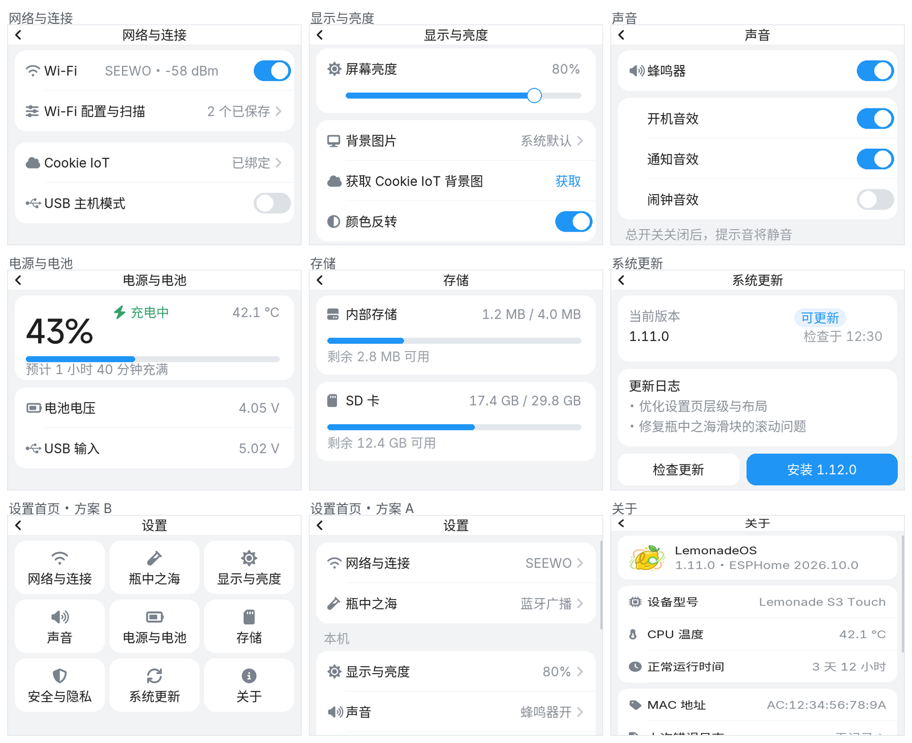
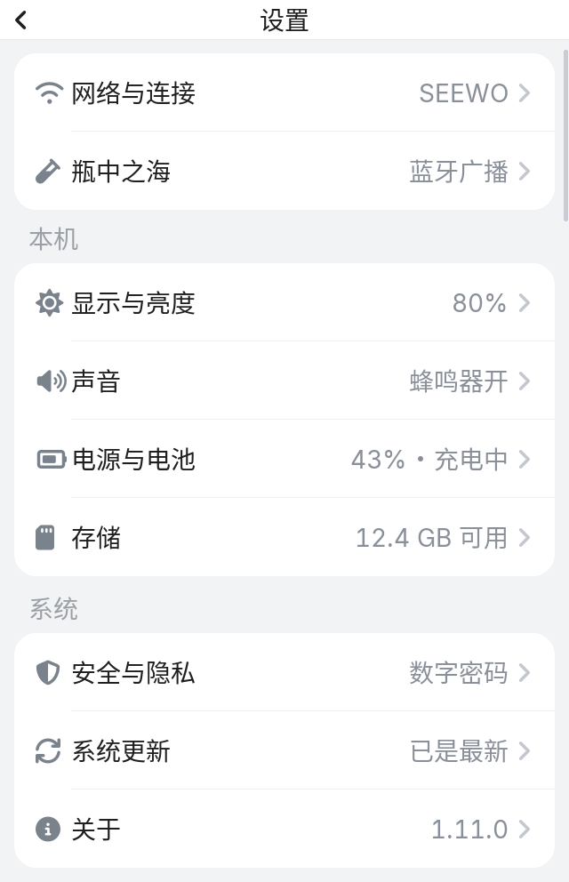
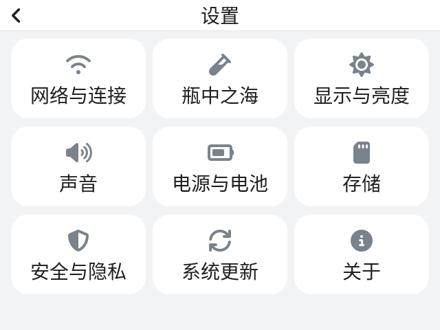
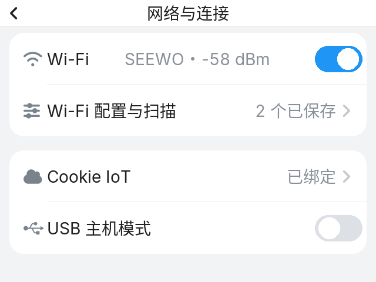
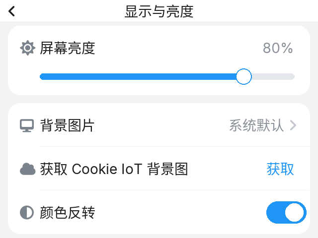
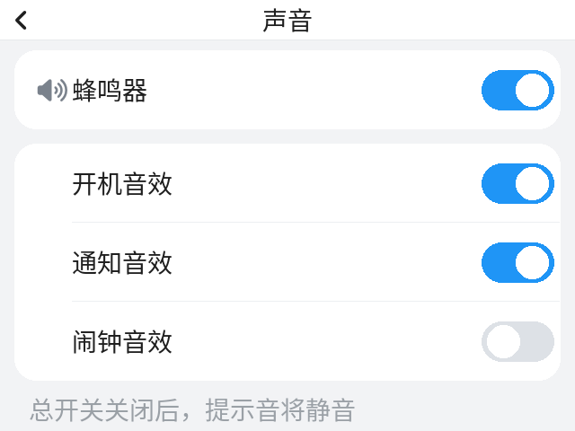
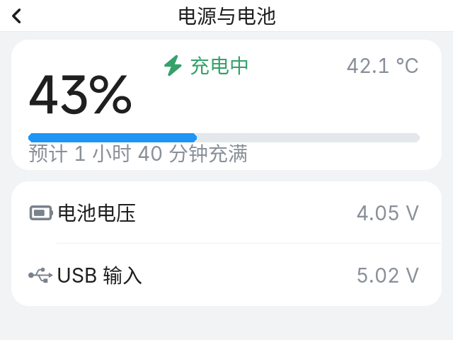
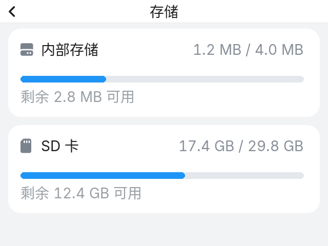
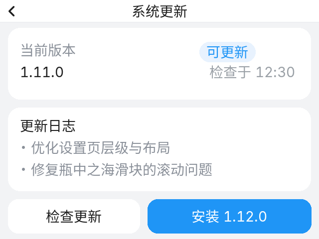
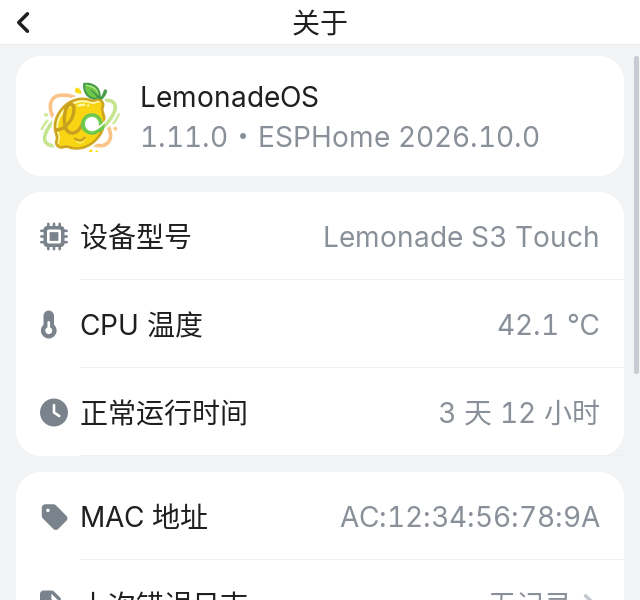

# 设置页层级与 UI 优化方案

> **状态：已按方案 A（分组列表 + 状态摘要）实现。** 代码在 `packages/s3_touch/features/setting/`、`security-lvgl.yaml`、`lvgl.yaml`、`script.yaml`、`hardware.yaml`、`back_gesture.yaml`、`resources.yaml`。已通过 `esphome config touch_canary.yaml` / `touch_public.yaml` 校验，未编译。
>
> 文中预览图是按 320×240、14px Sarasa UI SC、Font Awesome 7 实际渲染的近似稿（`generate_mockups.py` 可重新生成），不是最终固件截图。



## 0. 结论先行

- **首页从 11 项平铺改成 3 组 9 项**：网络与外设 / 本机 / 系统，每行右侧带状态摘要。
- **瓶中之海保留一级入口**，归到「网络与外设」——它是 BLE 遥控的第三方设备，不是壁纸/背景；页面本身重做成可滚动的参数面板。
- **二级页统一骨架**：顶栏（返回 + 标题）+ 分组白卡 + 44px 行，行 = 图标 + 标题 + 状态值 + 箭头。
- **合并/删除**：USB 独立页降级为网络页一行；空的通知页删除；IoT 裸文本页结构化；关于页 9 张卡压成 3 张。
- **顺带修 4 个现存布局 bug**：显示页控件重叠、瓶中之海滑块/按钮出屏、安全页「立即锁屏」不可见、更新页日志被截断。

---

## 1. 现状审计

### 1.1 层级（信息架构）问题

| # | 问题 | 位置 |
|---|---|---|
| 1 | 首页 11 个 list 按钮 + 2 个分组标题（共 13 行），低频项（关于/更新）和高频项（网络/显示）混排，222px 可视区约 5 行，要滚 2 屏以上 | `setting-lvgl.yaml:123-244` |
| 2 | 分组语义不成立：「互联互通」里放瓶中之海（BLE 设备）、USB（外设）；「系统」里放显示/声音（本机偏好） | `setting-lvgl.yaml:131,169` |
| 3 | 菜单名与页面标题不一致：IoT 平台 → Cookie IoT；存储 → 存储设置 | `setting-lvgl.yaml:142,200,1217` |
| 4 | 深度不均：Wi-Fi 要 菜单→网络→配置→AP→密码；而「上次错误」页没有任何入口，只在崩溃后由脚本直接切屏 | `setting-lvgl.yaml:1106`；`script.yaml:761` |
| 5 | 「通知设置」是空页面，仍占 id 和返回手势映射 | `setting-lvgl.yaml:1376-1381` |
| 6 | 「关于」9 张卡片排到 y=968，要滚 4 屏；版本信息又与「系统更新」重复 | `setting-lvgl.yaml:648-927` |
| 7 | 网络页一个页面塞了开关、状态、配置入口、获取配置、恢复默认 5 个动作，主次不清 | `setting-lvgl.yaml:563-646` |

### 1.2 UI / 布局问题

| # | 问题 | 位置 | 现象 |
|---|---|---|---|
| 1 | 显示页控件互相压 | `setting-lvgl.yaml:396-455` | 下拉框 y=73（38 高）与「背景图片」label y=83 重叠；下方获取按钮与「颜色反转」行挤在一起，开关越出 185px 容器 |
| 2 | 瓶中之海控件出屏 | `setting-lvgl.yaml:956-1095` | 容器 185px，第 5/6 组滑块排到 y=238/288；「应用设置」按钮 `BOTTOM_MID y=185` 完全在屏外 |
| 3 | 安全页按钮不可见 | `security-lvgl.yaml:85-214` | 200px 容器里按钮 `align: CENTER, y: 120`，中心落在 240，实际点不到 |
| 4 | 更新页日志被截 | `setting-lvgl.yaml:1145-1210`、`setting-script.yaml:60-86` | 日志从 y=146 起最多 7 行，超出 240；逻辑还硬截 260 字符 |
| 5 | 三种页面骨架混用 | 各页 | 居中 obj + 绝对坐标（33/73/113/153）、裸 label（24/64/104/144）、默认 list（53）三种行距 |
| 6 | 首页是默认主题 list | `setting-lvgl.yaml:123` | 与「关于」自绘白卡（radius 10 / #e6e6e6）风格割裂，没有统一 token |
| 7 | 没有返回控件 | 全部 | 只有边缘手势；进入设置后没有可见返回入口 |
| 8 | 顶栏标题贴边 | `lvgl.yaml:19-26` | y=-1、height=15，14px 字上下都紧 |
| 9 | 危险操作无区分 | `setting-lvgl.yaml:646,95-115` | 恢复默认网络、系统更新与普通按钮同色，且恢复默认就放在 Wi-Fi 页首屏 |
| 10 | 空/错误态缺失 | IoT、存储 | IoT 直接输出多行文本；存储只有两行字，没有进度条 |

---

## 2. 设计原则

1. **两层为主**，三层只留给设备操控/向导（Wi-Fi 流程、瓶中之海参数）。
2. **能一屏看完的页面不滚动**；必须滚动时给分组标题 + 滚动条。
3. **行即组件**：44px 高、整行可点、右值 + 箭头，重复 20 次也不用重写布局。
4. **状态前置**：首页直接显示「已连接 SEEWO / 43% · 充电中 / 已是最新」，减少进页确认。
5. **一套令牌**：颜色、圆角、行高、间距全部来自同一个 styles 文件。
6. **危险动作**统一红色 + 二次确认，固定放在页面底部。
7. **不新增字体**：层级靠颜色、留白、分组和 36px 数字（现有 `chinese_font36`）来拉，避免 flash 和内存开销。

---

## 3. 新信息架构

```
设置
├─ 网络与外设
│  ├─ 网络与连接        → Wi-Fi 开关/状态、Wi-Fi 配置与扫描、Cookie IoT、USB 主机模式
│  └─ 瓶中之海          → 色调/亮度/活跃/压力/推力/液面（BLE 广播遥控第三方设备）
├─ 本机
│  ├─ 显示与亮度        → 亮度、背景图片、获取背景图、颜色反转
│  ├─ 声音              → 总开关 + 开机/通知/闹钟
│  ├─ 电源与电池        → 电量、充电状态、电压、温度
│  └─ 存储              → 内部存储、SD 卡（进度条）
└─ 系统
   ├─ 安全与隐私        → 锁屏方式、密码、息屏锁定、自动息屏、立即锁屏
   ├─ 系统更新          → 当前/最新版本、检查、日志、安装
   └─ 关于              → 品牌条、设备、系统、标识 + 上次错误日志入口
```

关键调整：

- **瓶中之海不再叫「动态背景」，也不进显示页**。它是设备操控页，放在「网络与外设」组，与网络并列一级入口。以后如果想更突出，可以把它做成主屏磁贴/独立应用，设置里只留入口。
- **USB 从独立页降级为网络页的一行**：它是「Type-C 读外接 CDC 设备」的高级开关，不值得占用一个首页位置。
- **通知页删除**，**上次错误日志收进「关于」**，给诊断信息一个正式入口。
- **命名统一**：菜单与页面标题一致（网络与连接 / 显示与亮度 / 声音 / 电源与电池 / 存储 / 安全与隐私 / 系统更新 / 关于 / 瓶中之海）。

页面深度：首页 → 二级页（9 个）→ 三级（Wi-Fi 配置 / 瓶中之海参数 / IoT 详情）→ 四级（添加 Wi-Fi 密码）。与现在相比，Wi-Fi 仍是 3 步到密码页，没有变深。

---

## 4. 视觉规范（320 × 240）

| 项 | 规范 |
|---|---|
| 顶栏 | 22px 高，左返回 14px、标题 14px 居中、底部 1px `#E7E9EC`；设置页隐藏日期/时间（回主屏恢复） |
| 页面底 | `#F2F3F5` |
| 卡片 | `#FFFFFF`，圆角 12，无边框/阴影 |
| 行 | 高 44，图标 14px @ x=12（`#7A828C`），标题 x=32（14px `#1F1F1F`），右值右对齐（14px `#8A9099`），箭头 14px `#C3C7CE` |
| 分隔线 | 1px `#EDEFF2`，从文字起点 x=32 画到卡片右边（iOS 风格内缩） |
| 分组标题 | 14px `#9AA0A6`，x=16；距上一卡片 12，距下一卡片 6 |
| 开关 | 40×22，开 `#1F95F6`，关 `#DDE1E6` |
| 滑块 | 轨道 6px `#E4E7EB`，进度 `#1F95F6`，圆钮 18 |
| 按钮 | 主按钮 34 高、圆角 10、`#1F95F6`；次按钮白底；危险按钮红字/红底 `#E5484D` |
| 状态色 | 成功 `#35A16B`，危险 `#E5484D`，强调 `#1F95F6` |
| 字号 | 仅 14 / 18 / 36，不新增字体 |

---

## 5. 逐页改造

### 5.1 首页（方案 A，推荐）



- 卡片 1（y=30，h=88）：网络与连接（`SEEWO`）、瓶中之海（`蓝牙广播`）。
- 分组「本机」（y=134）：显示与亮度（`80%`）、声音（`蜂鸣器开`）、电源与电池（`43% · 充电中`）、存储（`12.4 GB 可用`）。
- 分组「系统」（y=342）：安全与隐私（`数字密码`）、系统更新（`已是最新`）、关于（`1.11.0`）。
- 内容总高约 496px，容器 216px：一屏显示 4 行，其余滚动，右侧有滚动条。
- 右侧状态由新脚本 `render_setting_menu` 在 `on_load` 刷新（SSID/亮度/蜂鸣器/电量/锁屏方式/版本/SD 剩余），不新增定时器。

另一条路线是 3×3 磁贴，一屏放全 9 项但没有状态摘要：



| | A 分组列表 | B 3×3 磁贴 |
|---|---|---|
| 一屏可见 | 4/9 行 | 9/9 |
| 状态摘要 | 有 | 无 |
| 点击目标 | 304×44 | 98×58 |
| 与主屏视觉 | 常规设置 | 更像应用启动器 |

### 5.2 网络与连接



- Wi-Fi 行：开关 + 状态（`SEEWO · -58 dBm`，离线时显示「已关闭/未连接」）。
- Wi-Fi 配置与扫描行：进入扫描页，右侧显示已保存网络数。
- Cookie IoT 行：状态（已绑定/未绑定）→ 详情页改成结构化 4 行（用户名、API 版本、Wi-Fi 数量、上次获取时间），不再输出裸文本。
- USB 主机模式行：开关 + 一行说明文字（读外接 CDC 设备，切换会重启 USB）。
- 「恢复默认网络配置」移出本页，放到 Wi-Fi 配置页底部，红色文字 + 现有确认框。

### 5.3 Wi-Fi 配置 / 添加 Wi-Fi

- 扫描列表分「已保存」「可用网络」两组；行右侧给信号格/锁图标。
- 点已保存 → 删除确认（现有 msgbox）；点可用 → 密码页。
- 底部主按钮「扫描」；底部危险卡「恢复默认网络配置」。
- 添加页：标题显示 SSID，密码框 + 键盘 + 明确「连接」按钮，取消返回上一页。

### 5.4 显示与亮度



- 亮度卡（70px）：图标 + 标题 + `80%` + 滑块。
- 外观卡（132px，3 行）：背景图片（当前「系统默认」）、获取 Cookie IoT 背景图（右侧强调「获取」）、颜色反转（开关）。
- 背景图选择收进选择弹层（系统默认 / Cookie IoT / 重新获取），替掉现在错位的下拉框 + 大按钮。
- 修掉与下拉、按钮、开关的重叠和越界。

### 5.5 声音



- 总开关卡 + 提示音卡（开机/通知/闹钟 3 行）。
- 总开关关闭时：子项置灰 + 底部说明「总开关关闭后，提示音将静音」，而不是静默 disable。

### 5.6 电源与电池



- 电量 hero：`43%`（36px）+ 充电中/放电中 + 温度 + 进度条 + 预计满电/可用时间。
- 电压卡：电池电压、USB 输入两行。
- 可加一行「电源菜单」调用现有 `msgbox_power_menu`（锁屏/重启/关机），把危险操作集中。

### 5.7 存储



- 内部存储 / SD 卡两张卡，各带进度条、已用/总量、剩余。
- 无 SD 卡时显示「未检测到 SD 卡」，不显示 0。
- 修掉当前「总容量当剩余显示」的问题。

### 5.8 系统更新



- 版本卡：当前版本、状态 pill（可更新/已是最新）、上次检查时间。
- 日志卡：最多 4 行 + 省略号，或整页可滚动（不再硬截 260 字符）。
- 底部：检查（次）+ 安装（主）；无更新时只保留「检查更新」整宽按钮。
- 检查中：按钮置灰 + 「检查中…」，保留现有逻辑。

### 5.9 关于



- 品牌条：logo + LemonadeOS 版本 + ESPHome 版本。
- 设备卡：型号、CPU 温度、运行时间。
- 系统卡：LemonadeOS 版本、构建版本、构建日期、MAC。
- 法律卡：作者/版权折叠成两行。
- 新增行「上次错误日志 →」，给 `system_setting_previous_error_page` 一个入口。
- 尽量保留现有 `lbl_about_*` id，减少 `script.yaml` 改动。

### 5.10 瓶中之海（设备操控）

- 改成可滚动容器，内容从 y=24 开始，不再用 185px 固定高度硬塞。
- 两张卡：颜色（色调/亮度）、流体（活跃/压力/推力/液面）。
- 每组：标题 + 当前值 + 滑块（6px 轨道、18 圆钮）。
- 底部「应用设置」主按钮，随内容滚动或固定在底部安全区；修掉现在按钮在屏外的问题。
- 顶部加一行说明「通过 BLE 广播发送参数，应用后约 3 秒」，并可在应用后显示「已发送 HH:MM」。

### 5.11 安全与隐私

- 4 行控件（锁屏方式、改密码、息屏后锁定、自动息屏）统一为卡片行，下拉右对齐 130 宽。
- 「立即锁屏」改为底部按钮，修掉当前出屏点不到的问题。

### 5.12 OTA 页

- 保留全屏黑底，补进度百分比和「更新中，请勿断电」提示；返回手势禁用。

---

## 6. 落地方式（ESPHome / LVGL）

1. **新增 `packages/s3_touch/features/setting/setting-style.yaml`**：`lvgl: styles:` 定义 `style_card / style_row / style_row_title / style_row_value / style_group / style_switch / style_primary_btn / style_secondary_btn / style_danger_row`，各页用 `styles: [...]` / `style_id` 引用。
   - 不改全局 `theme:`，避免影响消息、计时器、应用商店等页面。
   - 首页/子页放弃默认 `list`，改成 `obj` + `button` 行；这样能拿到「双色图标 + 右侧状态 + 箭头」。
2. **顶栏**：`lvgl.yaml` 增加全局 `btn_topbar_back`（默认 hidden）；新增脚本 `setting_page_enter` / `setting_page_leave`（显示返回、隐藏日期时间 / 反向恢复）和 `setting_back`（按 `lv_screen_active()` 映射父页）。每个设置页 `on_load` / `on_unload` 各加一行调用。
3. **状态摘要**：`setting-script.yaml` 新增 `render_setting_menu`；更新页渲染函数改用新 label（当前版本/状态/检查时间/日志），保留 `btn_check_system_update`、`btn_update_system` 等 id 以复用逻辑。
4. **`script.yaml:refresh_info_page`**：把 `lbl_wifi_info` 的多行 SSID/RSSI/IP/MAC 文本改成单行摘要；关于页继续写 `lbl_about_*`。
5. **删除/合并**：`system_setting_usb_page`、`system_setting_notification_page` 删除，同步更新 `back_gesture.yaml:96-108` 的页面映射；Wi-Fi 配置/瓶中之海/安全的返回目标保持。
6. **图标**：`resources.yaml` 的 `chinese_font14` extras 增加约 20 个 Font Awesome 图标（wifi `f1eb`、display `f108`、volume `f028`、battery `f241`、shield `f3ed`、chip `f2db`、temp `f2c9`、tag `f02b`、file `f15c`、invert `f042`、cloud `f0c2` 等），约 3–5KB flash；USB 继续用 Brands 的 `f287`。
7. **不新增字体**，不改 LVGL 版本。

---

## 7. 分期与验证

| 期 | 内容 | 预估 |
|---|---|---|
| P0 | 设计令牌 + 顶栏返回 + 页面底色骨架 | 0.5 天 |
| P1 | 首页（分组 + 状态摘要 + 滚动） | 0.5 天 |
| P2 | 本机 4 页：显示 / 声音 / 电源 / 存储 | 0.5 天 |
| P3 | 网络页 + Wi-Fi 流程 + IoT 详情 + 删除 USB 页 | 0.5 天 |
| P4 | 系统 3 页：安全 / 更新 / 关于 + 错误日志入口 | 0.5 天 |
| P5 | 瓶中之海重排 + OTA 细节 | 0.5 天 |

每期验证：`esphome config` 校验 → 上机点一遍 → 检查 16-bit 下分隔线是否可见、44px 行触控、滚动与边缘返回手势是否冲突、`heap_free` 变化。

风险与对策：

- **对象数量增加**（约 +40 个 obj/button）：`use_psram` 已开，仍需实测 heap；若紧张，首页退回 `list` + `list_button` 样式（但没有右侧状态）。
- **长文本溢出**：SSID、构建日期、法律文案给固定 width + `long_mode: DOT`。
- **顶栏隐藏日期/时间** 是全局观感变化，需要确认。
- **页面 id 删除** 会影响返回手势映射，必须同批改。
- 不加字体意味着不能靠字重拉层级，只能靠颜色/留白/分组/36px 数字。

---

## 8. 已确认的决定

1. **首页用方案 A**：分组列表 + 每行状态摘要，允许滚动。
2. **瓶中之海保留一级入口**，归在「网络与外设」，页面重做成可滚动的 BLE 参数面板。
3. **五期一次做完**，用户自行编译；本次只做 `esphome config` 校验。
4. **设置页顶栏隐藏日期/时间 + 左侧返回箭头**；返回箭头同时支持边缘手势。

实现落点：

- `setting-style.yaml`（新增）：颜色/圆角/行高/按钮等设计令牌。
- `setting-lvgl.yaml`：13 个页面重排；删除 USB 页、通知页；新增「上次错误日志」入口。
- `setting-script.yaml`：`setting_page_enter/leave`、`setting_back`、`render_setting_menu`、`render_power_page`、`sync_bottle_ocean`；更新页状态渲染重写。
- `security-lvgl.yaml`：安全页改为卡片行 + 底部「立即锁屏」。
- `lvgl.yaml`：顶栏返回按钮、标题垂直位置、主屏隐藏返回按钮。
- `script.yaml`：Wi-Fi 摘要、IoT 字段、关于页字段、电量页联动。
- `hardware.yaml` / `s3_touch_3.2/hardware.yaml`：移除已删除的仪表指示器更新，电压文本保留。
- `back_gesture.yaml`：删除页映射、「上次错误日志」返回「关于」。
- `resources.yaml`：补充 10 个 Font Awesome 图标。

