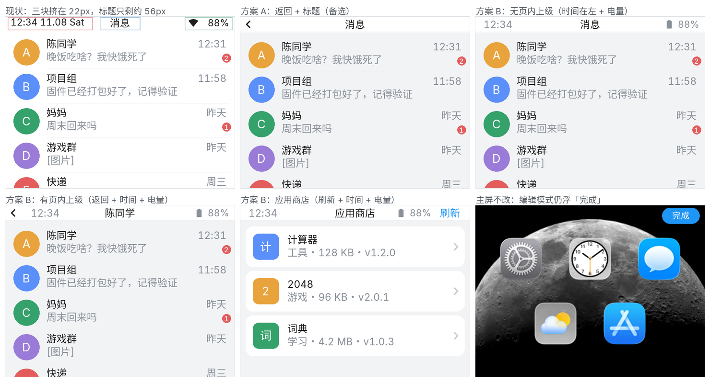
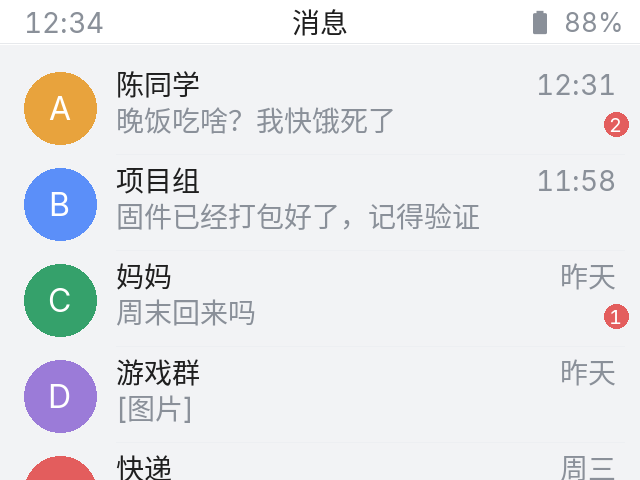
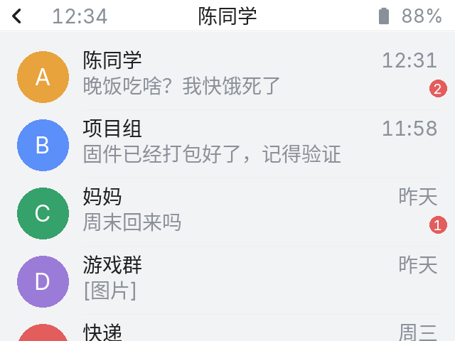
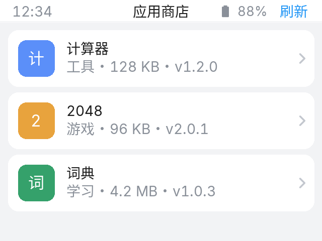
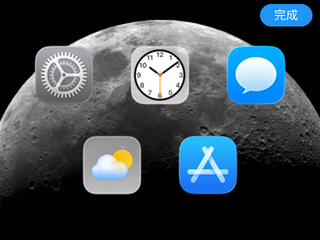

# 系统状态栏重构（已实现）

> 方案 B 定稿并落地：**返回（仅页内上级）+ 时间在左 + 标题居中 + 电量在右 + 页面动作**。
> 回主页交给物理 Home 键，状态栏不提供“回主页”。
> 已通过 `esphome config` 校验（touch_canary / touch_public / touch3.2_canary），未编译。



---

## 1. 最终布局

```
┌──────────────────────────────────────────────────────────────┐
│ ← 32 │ 12:34 │        标题 14px（居中）        │ 电量 │ 刷新 │
└──────────────────────────────────────────────────────────────┘
                         1px #E7E9EC
```

- 栏高 22px，白底 + 1px 底边；内容统一从 y=22 开始。
- 返回：只有“页内上级”才显示（设置子页、私聊、应用详情、Wi-Fi 配置、上次错误日志…）。
- 时间：`HH:MM`，14px `#8A9099`。有返回时 x=36，无返回时 x=12。
- 标题：14px `#1F1F1F`，居中，`long_mode: DOT`；可用宽度 150（有动作时 105）。
- 电量：MDI 电池图标 + 百分比，14px `#8A9099`，右侧 x=-4（有动作时 x=-44）；<20% 红色。
- 动作：应用商店“刷新”，44×22，蓝色文字。
- 沉浸页（主屏、锁屏/密码/图案、OTA、高温）：整条隐藏。
- Lua 应用：透明兼容，保留标题 + 时间 + 电量，无底板/返回；`ui.hide_topbar()` 可整条隐藏。

### 无页内上级（消息列表 / 设置首页 / 商店 / 计时器 / 天气）



### 有页内上级（私聊 / 设置子页 / 应用详情）



### 应用商店（刷新 + 时间 + 电量）



### 主屏不动



---

## 2. 页面规则

| 页面 | 模式 | 返回 | 右侧 |
|---|---|---|---|
| 主屏 | 沉浸（不改） | — | — |
| 主屏编辑 | 浮动“完成”（不改） | — | — |
| 设置首页 | 导航 | 无（Home 键） | — |
| 设置 13 个子页 | 导航 | 上级 | — |
| 应用商店 | 导航+动作 | 无（Home 键） | 刷新 |
| 应用详情 | 导航 | 应用商店 | — |
| 消息列表 | 导航 | 无（Home 键） | — |
| 私聊 | 导航 | 关闭私聊 | — |
| 计时器 / 天气 | 导航 | 无（Home 键） | — |
| Lua 应用 | 透明兼容 | 无（Home 键） | 时间 + 电量 |
| 锁屏 / 密码 / 图案 | 沉浸 | 原生逻辑 | — |
| OTA / 高温 | 沉浸 | — | — |

返回分发全部在 `page_back`：

```
设置子页 → 设置首页
Wi-Fi 配置 → 网络与连接 → 设置首页
添加 Wi-Fi → Wi-Fi 配置
Cookie IoT → 网络与连接
上次错误日志 → 关于
应用详情 → 应用商店
私聊 → 消息列表
密码/图案 → 锁屏
```

边缘手势也走 `page_back`；`bar_back_available` 为 true 时才显示手势箭头。

---

## 3. 实现

### 新增 `packages/s3_touch/statusbar.yaml`

- `statusbar_root` / `statusbar_bg` / `btn_topbar_back` / `lbl_bar_time` / `lbl_topbar_title` / `lbl_bar_battery` / `btn_app_store_refresh`
- 脚本：`statusbar_enter(title, back, action)`、`statusbar_compat(title)`、`statusbar_title(title)`、`statusbar_immersive`、`statusbar_overlay_hide`、`statusbar_restore`、`statusbar_update_status`、`page_back`
- 锁屏/高温这类临时覆盖页只藏栏不覆盖状态，解锁/恢复后 `statusbar_restore` 还原。

### 清理

- `lvgl.yaml`：删掉旧 `lbl_topbar_date` / `lbl_topbar_time` / `btn_topbar_back`；主屏隐藏整栏。
- `script.yaml`：`update_date` 里约 150 行顶栏 Wi-Fi/电量/日期逻辑删除，改为更新 `lbl_bar_time` + `lbl_bar_battery`；应用扫描改用 `statusbar_compat`。
- `setting-script.yaml`：删除 `setting_page_enter/leave/setting_back`。
- `back_gesture.yaml`：删除 target 映射与 `back_gesture_event`，改调 `page_back`。
- 全部页面的 `on_load` 改成一次 `statusbar_enter` / `statusbar_compat` / `statusbar_immersive`。

### 应用商店改版

- 列表：灰底 + 白色圆角卡片（304×56），左侧 36×36 彩色图标块（应用名首字），标题 + 副标题，右侧箭头；三张卡片。
- 底部：上页/下页文字按钮 + 居中状态文字。
- “刷新”从页内浮动按钮搬进状态栏右侧。
- 详情：白色描述卡 + 安装（蓝）/卸载（红）按钮，标题进状态栏并带返回。
- 图标颜色按索引循环：`#5B8FF9 / #E8A33D / #35A16B / #9B7BD8 / #E35D5D`。

---

## 4. 校验与注意事项

- `esphome config touch_canary.yaml` ✅
- `esphome config touch_public.yaml` ✅
- `esphome config touch3.2_canary.yaml` ✅
- 静态检查：所有 `id(...)` 引用可解析；新增中文文案都在 `chinese_font14` 覆盖范围内。

首机验证建议：

1. 顶栏时间/电量在设置、应用商店、消息、计时器、天气上是否都正常更新；
2. 无返回页（商店/消息/设置首页）不应出现返回箭头，物理 Home 能回主屏；
3. 应用商店卡片图标首字、颜色、三张卡的分页；
4. 私聊进入/退出时返回箭头与标题是否跟随；
5. 锁屏再解锁后，栏是否回到锁屏前的页面（含应用商店的刷新按钮）；
6. 应用商店详情返回、Wi-Fi 配置返回、上次错误日志返回；
7. 主屏编辑模式仍是右上角“完成”，没有被状态栏影响。

已知取舍：

- 状态栏只显示时间 + 电量，不含 Wi-Fi 信号；Wi-Fi 仍在主屏底部和锁屏。
- 标题固定宽度，长应用名/联系人名会 DOT 截断。
- Lua 应用透明兼容栏带标题 + 时间 + 电量，深色应用上对比度依赖应用自身背景；`ui.hide_topbar()` 可隐藏整条栏。
