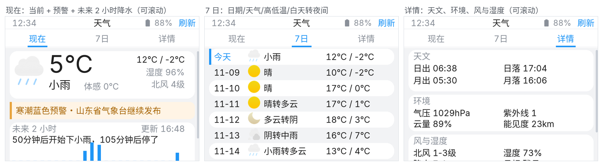
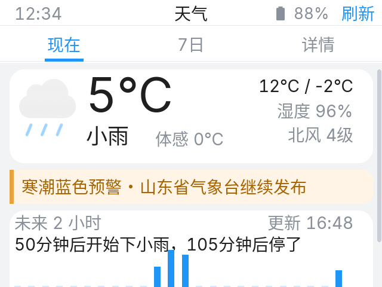
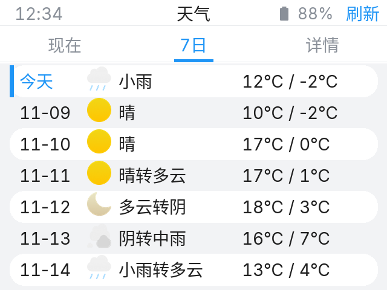
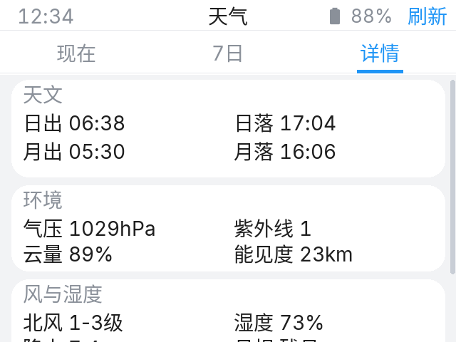

# 天气 UI 重构方案

> 已落地（P1–P4）：状态栏刷新、现在 / 7日 / 详情三页、分钟级降水、预警、7 日转场、详情卡片。
> 预览图按 320×240、Sarasa 14/18/36 渲染；生成脚本 `generate_mockups.py`。

## 0. 结构

- 页面仍是根页面（无返回），物理 Home 回主屏；
- 顶部状态栏：时间 / 天气 / 电量 / **刷新**；
- 下面 3 个 Tab：**现在 / 7日 / 详情**；
- **每个 Tab 页都可以上下滚动**，内容不再强行压在 185px 里；
- 内容超出时右侧显示细滚动条（`scrollbar_mode: ON`），不额外放滚动提示；
- 白底 Tab 栏 + 蓝色选中文字 + 32×2 下划线；
- 卡片统一白底、12 圆角，页面底 `#F2F3F5`。

---

## 1. 现在

- **当前卡** 304×78：
  - 48px 天气图标（现有 2x 图标）；
  - 40px 温度 `5℃`，18px 天气 `小雨`，14px `体感 0℃`；
  - 右上 `12℃ / -2℃`、`湿度 96%`、`北风 4级`。
- **预警条** 304×28（仅 `alert.zeroResult == false`）：
  - 琥珀底 + 左侧 3px 色条，14px `寒潮蓝色预警 · 山东省气象台继续发布…`，超长 DOT；
  - 无预警时隐藏，下面的分钟级卡和今日卡自然上移。
- **分钟级降水卡** 304×96：
  - 左上“未来 2 小时”，右上“更新 16:48”；
  - `minutely.summary` 一行（超长 DOT）；
  - 24 根 5 分钟柱（`detail[].precip`），零降水用浅蓝，非零用主蓝，柱高 30；
  - 底部时间刻度 `现在 / 30分 / 60分 / 90分 / 120分`；
  - 没有 `minutely` 时显示“暂无分钟级降水”。
- **今日卡** 304×76（在首屏下方，滚动可见）：
  - 降水 / 能见度 / 紫外线 / 气压 2×2。
- 首屏不再强行塞满，内容超过屏幕就滚动；右侧显示细滚动条，不再放“上滑查看更多”提示。

数据：`now.temp/text/feelsLike/icon/humidity/windDir/windScale/precip/vis/obsTime`、`forecast.daily[0].tempMax/tempMin`、`alert.zeroResult/headline`、`minutely.summary/detail[].precip`。

---

## 2. 7日

- 7 行，每行 26px，共 182px；仍然可以上下滚动；
- 列：日期（今天/明天/MM-DD）/ 20px 图标 / 天气 / `12℃ / -2℃`；
- **不显示风速/风力**；
- 白天/夜间不同时显示 `小雨转多云`；
- 今天左边 3px 蓝条，日期蓝字；隔行浅白卡；
- 少于 7 天时隐藏多余行。

数据：`forecast.daily[0..6]` 的 `fxDate/tempMax/tempMin/iconDay/textDay/textNight`。

---

## 3. 详情

可纵向滚动，卡片：

- **天文**：日出/日落、月出/月落、月相；
- **环境**：气压、紫外线、云量、能见度；
- **风与湿度**：白天/夜间风向风力、湿度、降水；
- **预警**：完整 `alert.headline`；无预警显示“暂无气象预警”；
- 底部更新时间和数据源。

数据：`daily[0]` 的 `sunrise/sunset/moonrise/moonset/moonPhase/pressure/uvIndex/cloud/vis/humidity/precip/windDirDay/windScaleDay/windDirNight/windScaleNight`，以及 `now.vis/precip`。

---

## 4. 刷新动作

- `statusbar.yaml` 新增 `btn_weather_refresh`，36×22，文字「刷新」，位置同 App Store 刷新：
  - `statusbar_enter("天气", false, 3)`；
  - `action == 3` 时显示，电量左移到 `-44`，标题宽 105；
  - 点击执行现有 `weather_update` 脚本；
  - 其他页面 action 不是 3 时自动隐藏；
  - 锁屏/解锁通过 `statusbar_restore` 保留 action 3。
- 天气页 `on_load` 从现在的 `action: 0` 改成 `action: 3`。

---

## 5. 实现要点

1. **Tab 页面 `pad_all: 0` + `scrollable: true` + `scroll_dir: VER` + `scrollbar_mode: ON`**，三个内容页都设，允许上下滚动并显示细滚动条；Tab 栏和内容分别用 `tab_style` / `content_style`，避免上次聊天页那种“整体下移/左右滑动”。
2. **7 日行**用 7 组固定 id（7 图标 + 7×4 label）或 C++ 动态行；数据更新时用指针数组循环，避免 35 个手写赋值。
3. **24 根分钟柱**：首次更新时在容器里创建 24 个 `obj`（宽 4~5、间距 12），按 `precip/max` 设高度，底部对齐；零值用浅色。
4. **预警隐藏重排**：现在页可滚动，预警条隐藏后分钟卡/更新时间上移；可以用 flex 或两套 y，避免留 22px 空洞。
5. **容错**：`minutely`、`alert`、`daily` 缺失或不足 7 天时不要越界；`daily[0]` 为今天。
6. **保留**主屏 `lbl_current_weather_text_main` 和锁屏 `lbl_lock_weather` 的“天气 温度”更新。
7. **图标**沿用现有 `weather_icon_1x/2x` 映射，不新增图片。
8. 字体仍只用 14/18/36；不新增字体。

---

## 6. 分期

| 期 | 内容 |
|---|---|
| P1 | 状态栏「刷新」+ 现在页（当前卡/预警/分钟卡/更新时间） |
| P2 | 7 日页（无风速，白天转夜间） |
| P3 | 详情页 + 滚动 |
| P4 | 容错、缺失数据文案、上机微调 |

---

## 7. 已按反馈调整

- 三个 Tab 页都允许上下滚动，不再强行塞进 185px；滚动条本身就是提示，不再加“上滑查看更多”；
- 7 日去掉了风速/风力列，保留“白天转夜间”；
- 状态栏电量图标/百分比重新对齐，刷新按钮在右侧；
- 渲染图其他错位（详情页第三张卡裁切）是因为详情页本身可滚动，实际滑动即可看到完整内容。

---

## 8. 落地记录

已实现：

- `statusbar.yaml` 增加 `btn_weather_refresh`（action 3），天气页 `statusbar_enter("天气", false, 3)`，点击执行 `weather_update`；
- `weather-lvgl.yaml` 重写为 3 个 Tab，均可上下滚动、`pad_all: 0`、`scrollbar_mode: ON`，白底 Tab + 蓝色下划线指示；
- 现在页：当前卡、预警条（无预警自动上移分钟卡/今日卡）、24 根分钟降水柱、今日卡、更新时间；
- 7 日页：7 行日期/图标/天气转场/高低温，无风速；
- 详情页：天文、环境、风与湿度、预警、更新时间，可滚动；
- `weather.yaml` 解析 now / alert / minutely / forecast.daily，温度统一 `℃`；
- 主屏和锁屏的“天气 温度”继续更新。

校验：`esphome config` 的 touch_canary / touch_public / touch3.2_canary 全通过；未编译。

上机重点：

1. 天气页右上“刷新”是否出现，点击后数据是否更新；
2. 三个 Tab 能否上下滚动，7 日是否没有风速、转场文字是否正确；
3. 分钟柱是否随降水变化，无分钟数据时是否显示“暂无分钟级降水”；
4. 预警出现/消失时，分钟卡和今日卡是否上移/下移；
5. 温度是否显示为 `5℃` / `12℃ / -2℃`。
